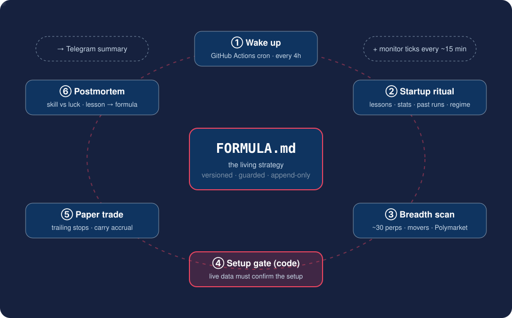
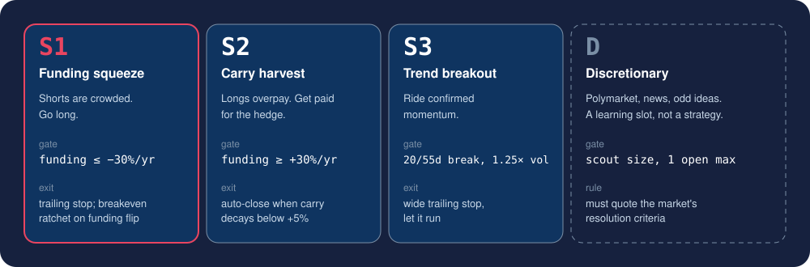
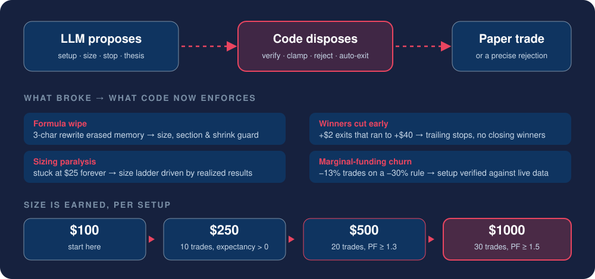
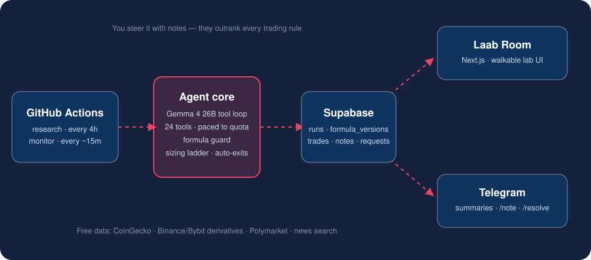

<p align="center"></p>

<p align="center">
  
  
  
  
</p>

## What it is

Loob wakes up on a schedule, scans crypto perps and prediction markets, opens **paper** trades, and rewrites its own strategy document, [`FORMULA.md`](FORMULA.md). You watch it work in the **Laab Room**, a small walkable lab. No real money moves.

## The loop

<p align="center"></p>

## Four setups, each gated by live data

<p align="center"></p>

The agent names a setup. **Code** checks the market and rejects the trade if the condition isn't true.

## LLM proposes, code disposes

<p align="center"></p>

## Is it self-learning?

**Self-improving, not self-training.** Model weights never change. What changes is the memory the next run reads, and the rules code enforces.

| | |
|---|---|
| ✅ Every closed trade needs a structured postmortem (skill vs luck, lesson) | feeds `FORMULA.md` |
| ✅ Position size is earned from each setup's realized results | code-owned, not LLM-owned |
| ✅ Every formula version is stored and guarded | nothing is ever lost |
| ❌ No fine-tuning, RL, or backtests | the model is the same every run |
| ❌ No confidence-vs-outcome calibration yet | on the roadmap |

## Architecture

<p align="center"></p>

```
packages/shared      Zod schemas, formula guard
packages/db          Supabase client, queries, migrations
packages/agent-core  Gemma tool loop, 24 tools, sizing ladder, runner
apps/agent           research-tick · monitor-tick entry points
apps/web             Laab Room UI + Telegram webhook
```

## Run it

```bash
pnpm install
cp .env.example .env            # Supabase, Gemini key, Telegram
pnpm db:migrate:local
pnpm build
pnpm --filter @loob/agent run research
pnpm --filter @loob/web dev     # Laab Room on :3000
```

Deploy: push to GitHub (Actions runs the agent), connect `apps/web` to Vercel. Env vars and internals live in [`CLAUDE.md`](CLAUDE.md).

## Steer it

Send `/note <text>` on Telegram or in the web UI. Notes are directives and outrank every trading rule. `/resolve <id> <text>` answers questions the agent asks you.

<p align="center"><sub>Research tool, not financial advice. Paper trading only.</sub></p>
